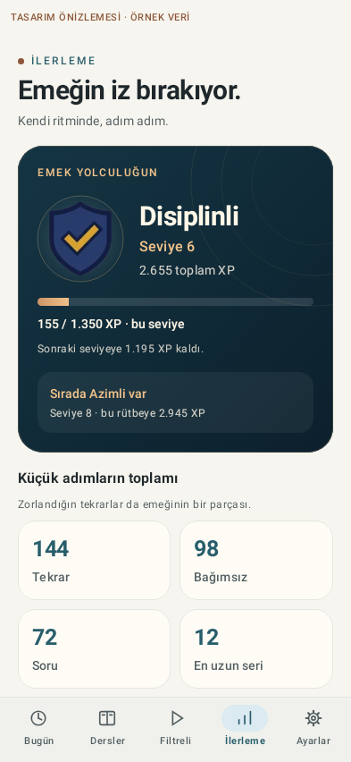

# P1 — arşivlenmiş Compose tasarım önizlemeleri

> Bu klasör 1.5.0 öncesi/1.5.0 yerleşimini koruyan tarihsel referanstır. Güncel 1.5.1 test
> çıktıları artık [progress](../progress/README.md) klasörüne yazılır; aşağıdaki üretme
> komutu yeni yerleşimi üretir, bu eski PNG’leri güncellemez.

Bu görüntüler **telefon ekran görüntüsü değildir**. `IlerlemeGorselOnizlemeTest`, gerçek Compose
bileşenlerini Robolectric'in native grafik motorunda çizer. Üstteki **ÖRNEK VERİ** etiketi
kasıtlıdır: 72 soru / 144 tekrar gibi sayılar yalnız `src/debug` fixture'ına aittir; APK'nın
release veri yolunda örnek soru veya uydurma süre yoktur. P2/P3 ile eklenen gerçek süre
referansları bu P1 örneklerinde gösterilmez; yalnız gerçek ölçüm biriktikten sonra oluşur.

## Görünümler

- [Açık tema / yoğun arşiv](p1-light.png)
- [Koyu tema / yoğun arşiv](p1-dark.png)
- [İlk gün / boş arşiv](p1-empty.png)
- [Hata / yeniden yükle](p1-error.png)
- [Koyu tema / %200 yazı](p1-large.png)



## Yeniden üretme

```bash
./gradlew :app:testDebugUnitTest --tests '*IlerlemeGorselOnizlemeTest'
```

Çıktı: `app/build/outputs/p1-previews/`. CI yalnız beş adlandırılmış, küçük PNG'yi bu belge
klasörüne taşır; rastgele build çıktısı veya kullanıcı verisi toplanmaz. Android Studio'da
`src/debug/.../SeviyeOnizlemeleri.kt` ayrıca yükleniyor dahil altı Preview içerir.

Normal ölçekte 2×2 istatistikler; büyük yazıda dikey kahraman alanı, tek sütun sayılar/rozetler
ve metinsel tekrar takvimi kullanılır. Ekran kaydırılabilir; büyük yazı görüntüsü yalnız ilk
viewport'u gösterir. XP/rozet koleksiyonları varsayılan kapalıdır. Animasyon kapalı önizleme
ile çalışan eylemler aynı bileşenlerdir.

Bunlar **piksel karşılaştırmalı golden testler değil**, tekrar üretilebilir inceleme
çıktılarıdır. Davranış/erişilebilirlik regresyonları `PremiumIlerlemeTest` ve mevcut
`IlerlemeArayuzTest` içindedir. Gerçek S24 FE, sistem gezinme biçimleri, TalkBack, döndürme,
arka plan/süreç ölümü ve performans kabulü ayrı olarak bekler.
